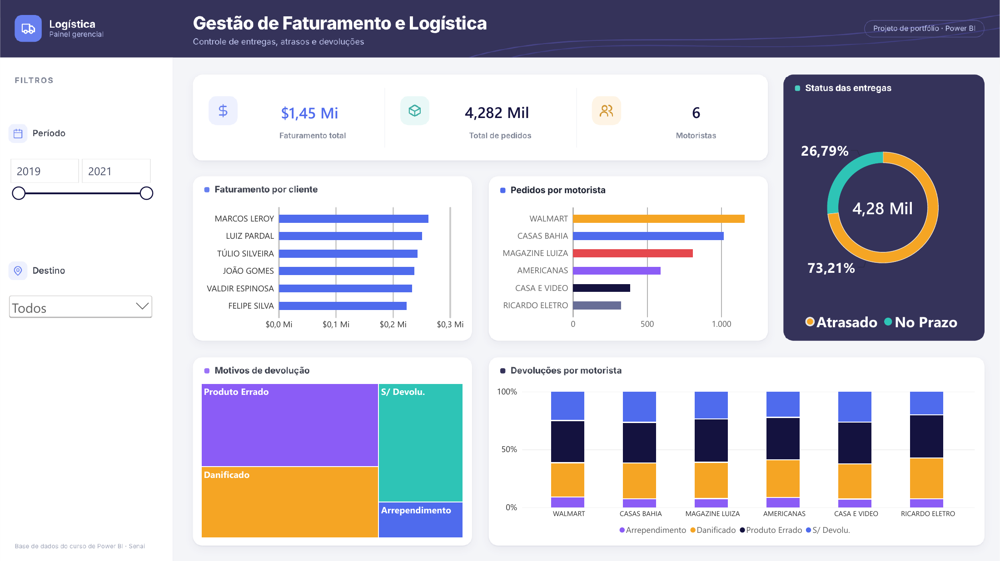
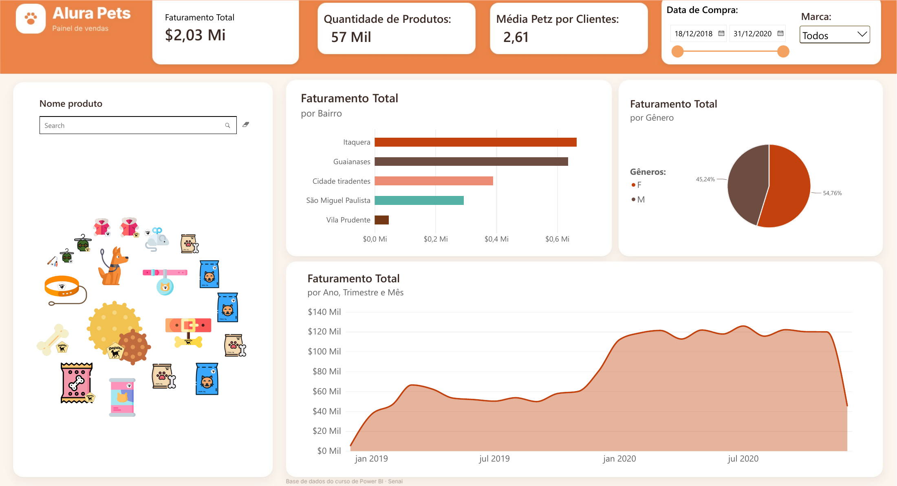

# 📊 Portfólio Power BI — Matheus Cadoni

Painéis desenvolvidos no curso de Power BI do **Senai**, com layout e tema de cores redesenhados por mim. Cada pasta traz o arquivo `.pbix`, o tema de cores e uma explicação das perguntas de negócio e dos principais insights.

## Painéis

| | Painel | Pergunta de negócio |
|---|---|---|
|  | **[Gestão de Faturamento e Logística](logistica)** | Onde estão os atrasos e as devoluções nas entregas? |
|  | **[Alura Pets — Painel de Vendas](alura-pets)** | Quais regiões, públicos e períodos concentram o faturamento? |

## Como abrir

1. Baixe o arquivo `.pbix` da pasta do painel.
2. Abra no [Power BI Desktop](https://www.microsoft.com/pt-br/power-platform/products/power-bi/desktop) (gratuito).

## Autor

**Matheus Cadoni** · Analista de Dados · [LinkedIn](https://www.linkedin.com/in/matheus-cadoni-aab94a208) · [GitHub](https://github.com/Matheus074)
