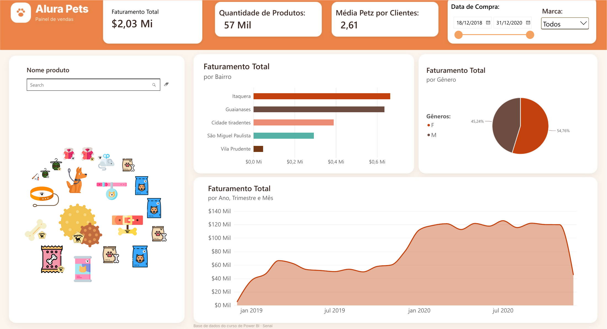

# 🐾 Alura Pets — Painel de Vendas

Painel de vendas de um pet shop fictício, com análise de faturamento por região, público e período, além de um catálogo visual de produtos.

## Perguntas que o painel responde

- Quanto a loja faturou e quantos produtos vendeu?
- Quais bairros concentram o faturamento?
- Como o faturamento se divide entre os públicos?
- Como as vendas evoluíram ao longo do tempo?

## Principais insights

- **Itaquera e Guaianases somam cerca de 64% do faturamento**: ações comerciais nesses bairros têm o maior retorno potencial, enquanto Vila Prudente quase não contribui.
- **O público feminino responde por 54,8% do faturamento.**
- **O faturamento mensal praticamente dobrou de 2019 para 2020**, passando de uma faixa de R$ 50 a 65 mil para R$ 110 a 125 mil por mês.
- Cada cliente tem, em média, **2,6 pets**, um bom sinal para estratégias de venda recorrente (ração, higiene, acessórios).

## Números do período (dez/2018 a dez/2020)

| Indicador | Valor |
|---|---|
| Faturamento total | R$ 2,03 milhões |
| Produtos vendidos | 57 mil |
| Média de pets por cliente | 2,61 |

## O que tem no painel

- **Filtros:** data de compra, marca e busca por nome de produto
- **Indicadores:** faturamento, quantidade de produtos e média de pets por cliente
- **Gráficos:** faturamento por bairro, por gênero e ao longo do tempo (ano, trimestre e mês)
- **Catálogo:** grade com as imagens dos produtos, filtrável pela busca

## Arquivos

| Arquivo | Descrição |
|---|---|
| `dash_alura_pets.pbix` | Relatório do Power BI (usa os visuais personalizados *Image Grid* e *Text Filter*) |
| `tema_alura_pets.json` | Tema de cores (pode ser importado em *Exibir → Temas → Procurar temas*) |
| `dashboard.png` | Imagem do painel |

## Créditos

Projeto prático "Alura Pets", feito durante o curso de Power BI do **Senai**. O layout foi redesenhado com fundo, tema de cores e organização visual próprios.
