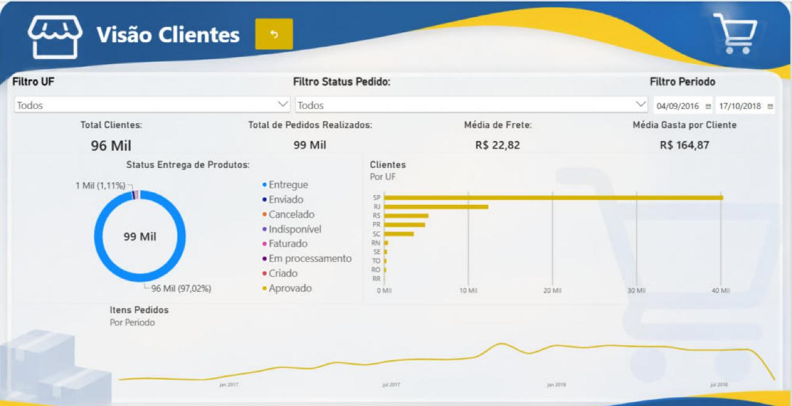
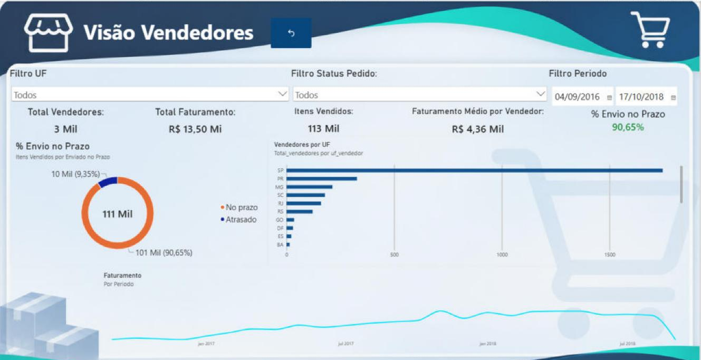

# 🛒 E-commerce Olist — Visão Clientes e Vendedores

Painel de análise de um marketplace brasileiro, com base nos dados públicos da **Olist** (cerca de 100 mil pedidos entre 2016 e 2018). Uma tela inicial leva a duas visões: **Clientes** e **Vendedores**.


## Perguntas que o painel responde

- Quantos clientes, pedidos e itens o marketplace teve no período?
- Onde estão os clientes e os vendedores?
- Quanto foi faturado, e qual o ticket médio por cliente e o frete médio por pedido?
- Os vendedores despacham os pedidos dentro do prazo?
- Como faturamento e volume de itens evoluíram mês a mês?

## Principais insights

- **São Paulo concentra 42% dos clientes e 60% dos vendedores**, seguido de RJ e MG (clientes) e PR e MG (vendedores).
- **O faturamento de jan–ago/2018 foi 2,4 vezes o de jan–ago/2017** (R$ 7,34 mi contra R$ 3,08 mi): o marketplace estava em forte crescimento.
- **Novembro de 2017 foi o mês de maior faturamento** (cerca de R$ 1 milhão), puxado pela Black Friday.
- **Os 10% maiores vendedores respondem por 67% do faturamento**: a receita depende de poucos parceiros.
- **90,6% dos itens foram despachados dentro do prazo** combinado com o vendedor.
- **O frete equivale a 16,6% do valor dos produtos**, em média R$ 22,82 por pedido.
- A queda no fim das linhas do tempo não é uma queda real de vendas: a base termina entre agosto e outubro de 2018, com poucos pedidos registrados nos últimos meses.

## Números do período (set/2016 a out/2018)

| Indicador | Valor |
|---|---|
| Faturamento (produtos, sem cancelados) | R$ 13,50 milhões |
| Pedidos | 99.441 |
| Itens vendidos | 112.650 |
| Clientes únicos | 96.096 |
| Vendedores | 3.095 |
| Ticket médio por cliente | R$ 164,87 |
| Frete médio por pedido | R$ 22,82 |
| Pedidos entregues | 97,0% |
| Envio no prazo | 90,65% |

## O que tem no painel

- **Tela de seleção:** navegação por botões para as duas visões
- **Filtros:** UF, status do pedido e período da compra
- **Visão Clientes:** total de clientes, pedidos, frete médio e ticket médio; status dos pedidos (rosca), clientes por UF e itens vendidos por mês
- **Visão Vendedores:** total de vendedores, faturamento, itens vendidos, faturamento médio por vendedor e % de envio no prazo; envio no prazo × atrasado (rosca), vendedores por UF e faturamento por mês

| Tela de seleção | Visão Clientes | Visão Vendedores |
|---|---|---|
|  |  |  |

## Modelo de dados

```
tb_clientes (1) ─── (1) pedidos (1) ─── (*) tb_itens_pedidos (*) ─── (1) tb_vendedores
```

- **Power Query:** tipos numéricos e datas lidos com localidade *en-US* (os CSVs usam ponto decimal), remoção de duplicatas e de linhas com erro, e tabela de vendedores renomeada para português.
- **Coluna calculada `Enviado no Prazo`:** compara a data de entrega à transportadora com a data-limite de envio do vendedor.

### Principais medidas DAX

```DAX
Total Pedidos            = DISTINCTCOUNT(pedidos[id_pedido])
Itens Vendidos           = COUNTROWS(tb_itens_pedidos)
Total Clientes           = DISTINCTCOUNT(tb_clientes[id_cliente_unico])
Total_vendedores         = DISTINCTCOUNT(tb_itens_pedidos[id_vendedor])

Faturamento_total =
CALCULATE(
    SUM(tb_itens_pedidos[preco]),
    pedidos[status_pedido] <> "Cancelado"
)

Faturamento_medio_vendedor = DIVIDE([Faturamento_total], [Total_vendedores])
Frete Medio por Pedido     = DIVIDE(SUM(tb_itens_pedidos[valor_frete]), DISTINCTCOUNT(tb_itens_pedidos[id_pedido]))
Ticket Medio por Cliente   = DIVIDE(SUM(tb_itens_pedidos[Preco_total]), [Total Clientes])

% Envio no Prazo =
DIVIDE(
    CALCULATE(COUNTROWS(tb_itens_pedidos), tb_itens_pedidos[Enviado no Prazo] = "No prazo"),
    CALCULATE(COUNTROWS(tb_itens_pedidos), NOT ISBLANK(tb_itens_pedidos[Enviado no Prazo]))
)
```

## Arquivos

| Arquivo | Descrição |
|---|---|
| `dash_ecommerce.pbix` | Relatório do Power BI (os dados já estão importados no arquivo) |
| `dashboard.png` | Imagem da Visão Clientes |
| `imagens/` | Imagens das três telas do painel |

Os CSVs não estão no repositório por causa do tamanho. A base original está no Kaggle: [Brazilian E-Commerce Public Dataset by Olist](https://www.kaggle.com/datasets/olistbr/brazilian-ecommerce). Para atualizar os dados, ajuste o caminho dos arquivos no Power Query.

## Créditos

Projeto do curso de Power BI do **Senai**, com dados públicos da Olist. Layout, fundos e navegação redesenhados por mim.
