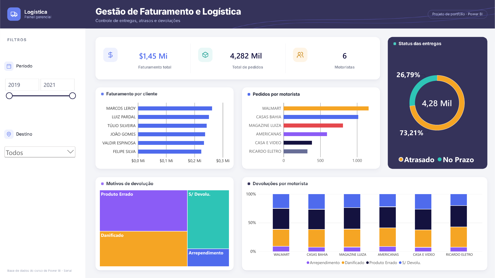

# 🚚 Gestão de Faturamento e Logística

Painel para acompanhar faturamento, pedidos, atrasos e devoluções de uma operação de entregas.

## Perguntas que o painel responde

- Quanto foi faturado e quantos pedidos foram entregues no período?
- Qual a proporção de entregas atrasadas e no prazo?
- Como os pedidos se distribuem entre os motoristas?
- Quais são os principais motivos de devolução, e como eles se distribuem por motorista?

## Principais insights

- **73% das entregas chegaram atrasadas**: apenas 26,8% foram entregues no prazo, o que indica um problema estrutural na operação, e não casos isolados.
- **Walmart é o motorista com mais pedidos**, seguido de Casas Bahia e Magazine Luiza: os três concentram cerca de dois terços das entregas.
- **"Produto errado" é o principal motivo de devolução**, seguido de "danificado". Os dois apontam para falhas de separação e manuseio no estoque, antes mesmo do transporte.
- O padrão de devoluções é **parecido entre todos os motoristas**, reforçando que a causa está no processo e não em pessoas específicas.

## Números do período

| Indicador | Valor |
|---|---|
| Faturamento total | R$ 1,45 milhão |
| Total de pedidos | 4.282 |
| Motoristas | 6 |

## O que tem no painel

- **Filtros:** período (ano) e destino
- **Indicadores:** faturamento, pedidos e motoristas
- **Gráficos:** faturamento por cliente, pedidos por motorista, status das entregas (rosca), motivos de devolução (treemap) e devoluções por motorista (100% empilhado)

## Arquivos

| Arquivo | Descrição |
|---|---|
| `dash_logistica.pbix` | Relatório do Power BI |
| `tema_logistica.json` | Tema de cores (pode ser importado em *Exibir → Temas → Procurar temas*) |
| `dashboard.png` | Imagem do painel |

## Créditos

Base de dados do curso de Power BI do **Senai**. O layout foi redesenhado a partir do template original do curso, com fundo, tema de cores e organização visual próprios.
